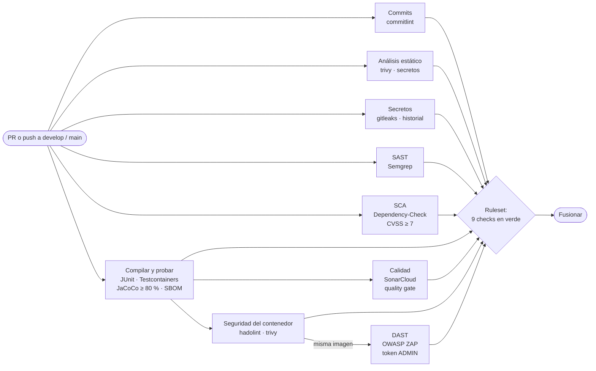

# API de afiliados

[](https://github.com/richard1992mv/api-afiliados/actions/workflows/ci.yml)
[](https://sonarcloud.io/summary/new_code?id=richard1992mv_api-afiliados)
[](https://sonarcloud.io/summary/new_code?id=richard1992mv_api-afiliados)

API REST para gestionar los afiliados de una caja de compensación: registrar, consultar, listar, actualizar
e inactivar. Aplica las reglas de negocio RN1 a RN4 (documento único, categoría según salario en SMMLV,
tipos de documento permitidos y afiliados inactivos no modificables) y protege el acceso con JWT y los roles
`ADMIN` (todo) y `CONSULTA` (solo lectura).

| | |
|---|---|
| Stack | Java 17, Spring Boot 4, Spring Security (OAuth2 Resource Server), MySQL 8.4, Flyway |
| Arquitectura | Hexagonal: `domain` → `application` → `infrastructure` ([ADR 0001](docs/adr/0001-arquitectura-hexagonal.md)) |
| Seguridad | Pipeline DevSecOps con 9 controles obligatorios ([ADR 0002](docs/adr/0002-herramientas-devsecops.md)) |
| Estándar | [Estándar de desarrollo](docs/estandar-desarrollo.md) · [Política de seguridad](SECURITY.md) |

## Pipeline

Cada PR hacia `develop` o `main` ejecuta el workflow [`ci.yml`](.github/workflows/ci.yml). El
[ruleset](https://github.com/richard1992mv/api-afiliados/settings/rules) exige los 9 checks para poder fusionar.



| Job | Técnica | Herramienta | Falla el build si… |
|---|---|---|---|
| Commits (commitlint) | Convención de commits | commitlint (solo en PRs) | un commit del PR no cumple Conventional Commits |
| Compilar y probar | Pruebas + cobertura + SBOM | JUnit, Testcontainers, JaCoCo, CycloneDX | una prueba falla o la cobertura baja del 80 % |
| Secretos (gitleaks) | Secret scanning | gitleaks (historial completo) | encuentra un secreto |
| Análisis estático | Secret scanning | trivy (fs) | encuentra un secreto de proveedor conocido |
| SAST (Semgrep) | SAST | Semgrep `p/java` + `p/owasp-top-ten` | encuentra un hallazgo |
| Calidad (SonarCloud) | SAST + calidad | SonarCloud | falla el quality gate |
| SCA (OWASP Dependency-Check) | SCA | Dependency-Check | una dependencia tiene CVSS ≥ 7 |
| Seguridad del contenedor | Imagen | hadolint, trivy (image) | el Dockerfile tiene errores o hay CVE CRITICAL/HIGH con parche |
| DAST (OWASP ZAP) | DAST | ZAP API scan con token ADMIN | una regla `FAIL` de [`.zap/rules.tsv`](.zap/rules.tsv) |

Los hallazgos de Semgrep y trivy se publican en la pestaña **Security**. El SBOM (`bom.json`, CycloneDX) se
guarda 90 días como artifact. Cada lunes, una ejecución programada sobre `main` revisa todo el historial con
gitleaks y busca CVE nuevos en las dependencias.

## Ejecutar en local

Requisitos: Docker y Java 17 (el wrapper `mvnw` descarga Maven).

```bash
cp .env.example .env        # completar los valores; JWT_SECRET: openssl rand -base64 32
docker compose up -d --build
```

- API: `http://localhost:8080/api/v1/afiliados` (requiere token Bearer)
- Documentación: `http://localhost:8080/swagger-ui.html`
- Estado: `http://localhost:8080/actuator/health`
- Tokens de prueba: con `SPRING_PROFILES_ACTIVE=dev` en el `.env`, `POST /dev/token?roles=ADMIN`.
  Ese endpoint solo existe en el perfil `dev`.

## Pruebas

Las pruebas de integración levantan MySQL con Testcontainers, así que Docker debe estar corriendo.

| Comando | Qué hace |
|---|---|
| `./mvnw test` | Pruebas unitarias, de integración y de arquitectura (ArchUnit) |
| `./mvnw verify` | Lo anterior más el umbral de cobertura de JaCoCo (80 %) y el SBOM. **Es lo que corre el pipeline.** |
| `./mvnw test -Dtest=EmailTest` | Una sola clase de prueba |

- Reporte de cobertura: `target/site/jacoco/index.html`
- SBOM: `target/bom.json`
- Pruebas de caja negra contra la API levantada: [colección Postman](postman/README.md)

## Cómo contribuir

### Ramas

| Rama | Uso | Protección |
|---|---|---|
| `main` | Versión estable; solo recibe releases desde `develop` | Ruleset: PR + 9 checks, sin force push ni borrado |
| `develop` | Integración del trabajo terminado | Igual que `main` |
| `fase-N`, `fix-…`, `chore-…` | Trabajo en curso, una rama por cambio | — |

Flujo: rama desde `develop` → PR hacia `develop` → pipeline en verde → **merge commit**. Para liberar, un PR
de `develop` hacia `main`, también con merge commit (no *squash*, para que ambas ramas compartan historia).

### Commits

[Conventional Commits](https://www.conventionalcommits.org/es/v1.0.0/) en español, en imperativo y con un
asunto de máximo 72 caracteres:

```text
tipo(alcance): descripción en imperativo

Cuerpo opcional que explica el porqué.
```

- **Tipos:** `feat`, `fix`, `test`, `refactor`, `docs`, `chore`, `ci`, `build`, `sec`
- **Alcances:** `domain`, `application`, `web`, `persistence`, `docker`, `pipeline`
- Ejemplo: `sec(web): protege la API con JWT HS256 y roles ADMIN/CONSULTA`
- El job **Commits (commitlint)** lo verifica en cada PR con [`commitlint.config.mjs`](commitlint.config.mjs).
  Para revisar un mensaje antes de commitear: `npm ci --ignore-scripts` una vez y luego
  `echo "feat(web): agrega X" | npx commitlint`.

Cada PR usa la [plantilla](.github/pull_request_template.md). Si cambia la arquitectura o una herramienta del
pipeline, incluye un [ADR](docs/adr/README.md).

## Riesgos aceptados

Cada riesgo se revisó y se acepta en este contexto. La columna *Revisar si* indica cuándo deja de ser aceptable.

| Riesgo | Detectado por | Por qué se acepta | Revisar si |
|---|---|---|---|
| CSRF deshabilitado | Sonar `java:S4502`, ZAP `10202` (IGNORE) | La API es stateless: el token viaja en la cabecera `Authorization`, que el navegador nunca agrega solo. Sin cookies ni sesión no hay nada que un sitio ajeno pueda reutilizar. | se usan cookies o sesión |
| CSP limitada a `frame-ancestors 'none'` | Revisión de cabeceras (OWASP REST Security Cheat Sheet) | La API solo devuelve JSON con `nosniff`, así que no hay HTML donde inyectar scripts. Una CSP completa (`default-src 'none'`) rompería Swagger UI. | la API sirve HTML propio |
| Sin HTTPS en el entorno DAST | ZAP `10106` (WARN) | El entorno del pipeline es efímero y local al runner. En producción TLS termina en el proxy o ingress, y la API ya envía HSTS en respuestas HTTPS. | la API se expone directamente sin proxy TLS |
| Swagger UI responde HTML | ZAP `100001` (WARN) | Es la interfaz de documentación, HTML por diseño. El resto de la API responde `application/json` o `application/problem+json`. | — |
| OpenAPI y Swagger UI públicos | Revisión manual | Facilitan la evaluación de la prueba técnica. En producción se apagan con `SWAGGER_ENABLED=false`. | se despliega en producción |
| Cobertura parcial del DAST en altas | Análisis del escaneo | ZAP reutiliza el documento de ejemplo del OpenAPI y la regla RN1 (duplicado) corta muchos ataques al `POST`. Esos campos los cubren las pruebas de validación y el SAST. | — |
| `swagger-ui` fijado en el pom | SCA (CVE de DOMPurify) | springdoc 3.2.0 trae una versión vulnerable. La versión se fija en el pom y en `springdoc.swagger-ui.version`. | springdoc trae ≥ 5.34.1 (quitar el override) |
| Sonar solo en PRs y en `main` | Limitación del plan gratuito | Todo cambio llega a `develop` por un PR que ya pasó el quality gate. | se cambia de plan |

### Riesgos conocidos pendientes (no aceptados)

| Riesgo | Mitigación prevista |
|---|---|
| JWT HS256: quien valida también puede firmar | Migrar a un proveedor de identidad con RS256/JWKS (por ejemplo Keycloak) |
| El rol CONSULTA ve documento y email completos (Ley 1581) | Enmascarar datos personales según el rol |
| Listado sin paginación ni rate limiting (OWASP API4) | Paginación y límite de peticiones |
| Actualizaciones concurrentes pueden pisarse | Bloqueo optimista con `@Version` |

## Reportar una vulnerabilidad

No abras un issue público: sigue la [política de seguridad](SECURITY.md).
